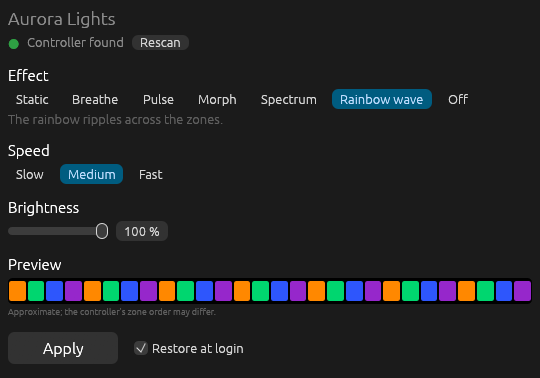
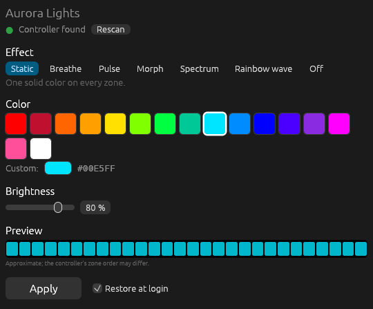
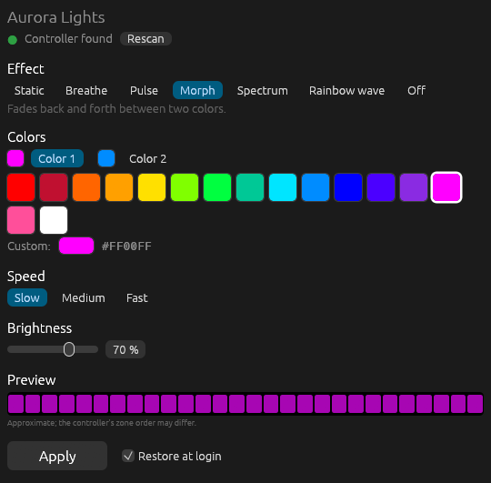

# Aurora Lights

A small GUI for the chassis RGB lighting on the **Dell Alienware Aurora R16**, for
**Linux and Windows**. Pick an effect, choose colors from a palette or a color
picker, set speed and brightness, and press **Apply**.

Effects: **Static**, **Breathe**, **Pulse**, **Morph** (two colors),
**Spectrum**, **Rainbow wave**, and **Off**.



| Static color from the palette | Morph between two colors |
| --- | --- |
|  |  |

## Download

Get the binary for your system from the
[latest release](../../releases/latest). Each one is a single self-contained
file with no runtime to install.

| System | File |
| --- | --- |
| Linux x86_64 (glibc 2.35+: Ubuntu 22.04, Debian 12, Fedora 36 or newer) | `aurora-lights-linux-x86_64` |
| Windows 10/11 x86_64 | `aurora-lights-windows-x86_64.exe` |

### Linux

```bash
chmod +x aurora-lights-linux-x86_64
./aurora-lights-linux-x86_64
```

The app needs read/write access to the controller's `/dev/hidrawN` node. If
you have OpenRGB's udev rules installed you already have it. Otherwise install
the [included rule](packaging/60-aurora-lights.rules) once, then log out and
back in:

```bash
sudo install -m 0644 60-aurora-lights.rules /etc/udev/rules.d/
sudo udevadm control --reload-rules
sudo udevadm trigger --subsystem-match=hidraw
```

### Windows

Run `aurora-lights-windows-x86_64.exe`. No administrator rights are needed.
The binary is not code-signed, so SmartScreen may warn on first launch
(**More info → Run anyway**).

If Alienware Command Center is installed, it may override the lighting you
set here. Close it or turn off its lighting control.

## Usage

The window shows **Controller found** when the controller is detected (hover
over it to see the device path).

Every successful **Apply** is saved. Tick **Restore at login** to reapply the
saved setting each time you log in. The controller forgets the effect when it
loses power, so this is how your choice survives a restart. Keep the
executable where it is after ticking the box, or reopen the app from its new
location so it updates the login entry.

| | Linux | Windows |
| --- | --- | --- |
| Saved setting | `~/.config/aurora-lights/settings.json` | `%APPDATA%\aurora-lights\settings.json` |
| Login entry | `~/.config/autostart/aurora-lights.desktop` | `HKCU\Software\Microsoft\Windows\CurrentVersion\Run`, value `Aurora Lights` |

Command line:

```bash
aurora-lights              # open the GUI
aurora-lights --restore    # reapply the saved setting without a window
```

## Why this exists

The R16's lighting controller (the Alienware AW-ELC, USB `187c:0550`) speaks
the same command protocol as older Aurora models, but its firmware exposes it
differently:

| | Older Aurora models | Aurora R16 (platform `0x0810`) |
| --- | --- | --- |
| HID reports | feature / numbered reports | one unnumbered 33-byte input and output report only |
| Sending a command | feature report or `SET_REPORT` | output report on the interrupt OUT endpoint |
| Reading the reply | feature report | `GET_REPORT` (Input, ID 0) |

As of OpenRGB 1.1, its Alienware driver reads the R16 as
`Unknown platform: 0, Number of zones: 0`. OpenRGB then falls back to the
"Dell G Series" driver, which can only turn the lights off. Tools that send
`SET_REPORT` to numbered reports lock the controller up until the PC is
unplugged. Aurora Lights uses the transport the R16 actually supports: hidraw
`write` + `HIDIOCGINPUT` on Linux, and `WriteFile` + `HidD_GetInputReport` on
Windows.

## Compatibility

Tested on:

- Alienware Aurora R16, AW-ELC firmware 1.1.9, platform `0x0810`, 71 zones
- Ubuntu with GNOME on X11

The Windows build uses the equivalent Windows HID calls but has not yet been
tested on hardware. Other machines with USB ID `187c:0550` may work if their
controller has the same HID descriptor. Please open an issue with your model
and result either way.

## Building from source

You need a Rust toolchain ([rustup](https://rustup.rs)).

```bash
git clone <this repository>
cd aurora-lights
cargo build --release          # target/release/aurora-lights
cargo install --path .         # or install to ~/.cargo/bin
```

On Linux, `packaging/aurora-lights.desktop` adds the app to your applications
menu (copy it to `~/.local/share/applications/`; it expects `aurora-lights` on
your `PATH`).

## Safety notes

- Effects are written to the controller's volatile animation slot. Nothing is
  saved to controller flash, and the startup animation is never changed.
- Do not run other lighting tools against the controller at the same time.
  The controller handles one command sequence at a time.
- If the controller ever stops responding, shut down, unplug the power cord
  for about 30 seconds, and boot again.

This is an unofficial, reverse-engineered utility. Use it at your own risk.

## Credits

The AW-ELC command set comes from the Alienware controller support in
[OpenRGB](https://gitlab.com/CalcProgrammer1/OpenRGB) and from
[alien-lights](https://github.com/JakeLaney/alien-lights). The effect timings
and the rainbow color sequence follow alien-lights.
